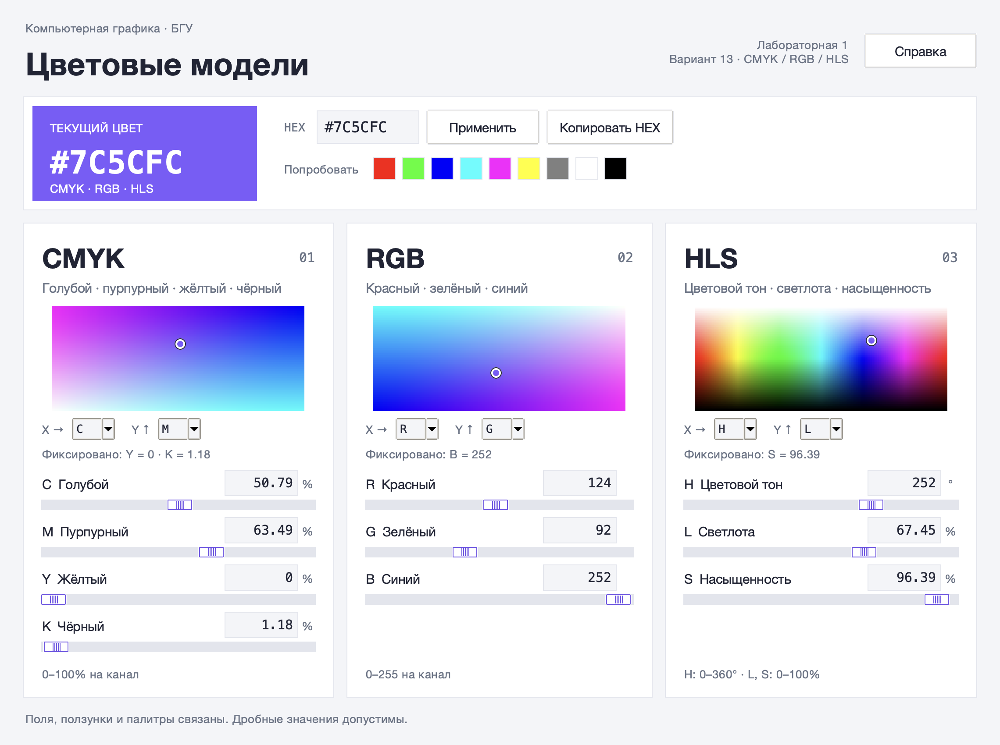

# Лабораторная 1. Цветовые модели

Вариант 13: **CMYK, RGB, HLS**. Python + Tkinter.

[Условие](assignment.pdf) · [Формулы](THEORY.md)

## Запуск

В этой папке открой двойным щелчком `Запустить лабораторную.command` (macOS) или `Запустить лабораторную.bat` (Windows).

Или выполни из этой папки:

```bash
python3 app.py
```

На Windows — `py app.py`. Нужен Python 3.10+ с Tkinter; устанавливать пакеты через pip не требуется. Проверка Tkinter: `python3 -m tkinter`.

## Управление

Каждая модель имеет числовые поля, ползунки и палитру. Изменения сразу пересчитываются в остальных моделях.

- В полях можно вводить дроби с точкой или запятой. Ошибочный ввод не меняет цвет.
- В палитре выбери две компоненты для осей X и Y. Остальные компоненты остаются постоянными; их можно менять ползунками.
- HEX вводится сверху и применяется по Enter или кнопкой. Рядом — готовые цвета и копирование HEX.

Диапазоны: RGB — 0–255; CMYK — 0–100%; H — 0–360°, L и S — 0–100%.



## Код

- `colors.py` — преобразования и состояние цвета.
- `app.py` — интерфейс и обработчики событий.
- `tests/` — тесты формул и виджетов.

CMYK рассчитан по учебной формуле без профиля принтера. Внутренние значения не округляются; поля показывают два знака после запятой, HEX — целые RGB-компоненты.

## Тесты

Из папки `labs/lab01`:

```bash
python3 -m unittest discover -s tests -p 'test_*.py' -v
python3 -m unittest discover -s tests -p 'gui_checks.py' -v
```

Вторая команда открывает тестовое окно и требует графического сеанса.
