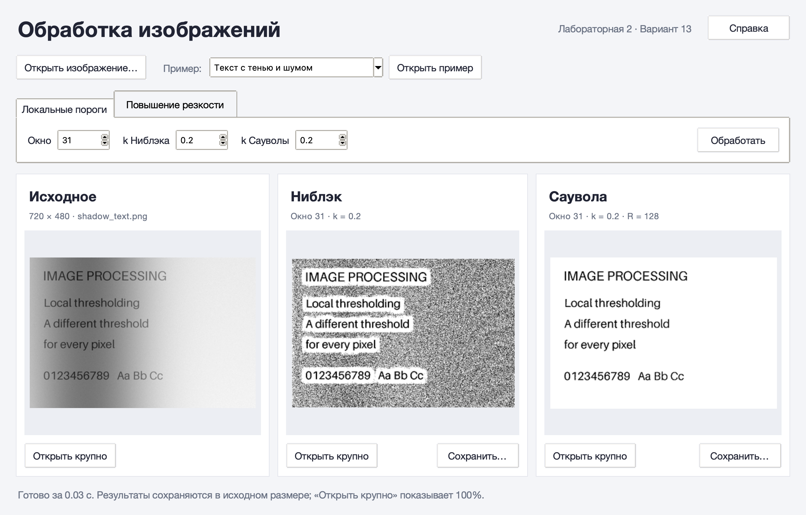

# Лабораторная 2. Обработка изображений

Вариант 13: локальная пороговая обработка и высокочастотные фильтры для повышения резкости.

[Условие](assignment.pdf) · [Отчёт PDF](report/report.pdf) · [Формулы и пояснения](THEORY.md) · [Сравнение методов на примерах](samples/RESULTS.md)

## Запуск

В этой папке открой двойным щелчком:

- **macOS:** `Запустить лабораторную.command`;
- **Windows:** `Запустить лабораторную.bat`.

Нужен Python 3.10+ с Tkinter. При первом запуске скрипт создаёт `.venv` и устанавливает NumPy и Pillow; для этого нужен интернет. Дальше программа работает без сети.

Вручную из этой папки:

```bash
python3 -m venv .venv
.venv/bin/python -m pip install -r requirements.txt
.venv/bin/python app.py
```

На Windows используй `py` вместо `python3` и `.venv\Scripts\python.exe` вместо `.venv/bin/python`.

## Управление

Открой своё изображение или выбери пример. Две вкладки сравнивают:

- **Локальные пороги:** Ниблэк и Саувола; настраиваются размер окна и коэффициенты.
- **Повышение резкости:** Лаплас и нерезкое маскирование; настраиваются усиление и σ гауссова размытия.

После изменения параметров нажми «Обработать» или Enter. «Открыть крупно» показывает изображение в масштабе 100%, «Сохранить…» записывает результат без уменьшения размера.



[Скриншот повышения резкости](docs/sharpen.png).

## Примеры

В `samples/` лежат четыре входных изображения, маска текста и эталон резкости. Они создаются скриптом `make_samples.py`; это синтетические примеры с известным исходным изображением.

На тексте с тенью и шумом лучше работает Саувола. На бледном тексте Ниблэк сохраняет слабые штрихи. Размытые и зашумлённые изображения показывают пользу повышения резкости и усиление шума. Численные результаты и параметры — в [samples/RESULTS.md](samples/RESULTS.md).

## Код и проверки

`processing.py` содержит формулы, `app.py` — интерфейс. Pillow читает, показывает и сохраняет изображения. Сами методы обработки реализованы через NumPy, без готовых фильтров OpenCV или scikit-image.

Команды из этой папки:

```bash
.venv/bin/python -m unittest discover -s tests -p 'test_*.py' -v
.venv/bin/python -m unittest discover -s tests -p 'gui_checks.py' -v
.venv/bin/python compare_samples.py
```

Вторая команда открывает тестовое окно. Для повторного создания набора изображений выполни `.venv/bin/python make_samples.py`.

## Отчёт

[PDF](report/report.pdf) и [исходник LaTeX](report/report.tex) находятся в `report/`.
Чтобы пересобрать PDF, установи Tectonic, шрифты Times New Roman (или Liberation Serif) и DejaVu Sans Mono. Из папки лабораторной:

```bash
cd report
tectonic report.tex
```

При первой сборке Tectonic скачивает пакеты TeX. Для просмотра готового PDF ничего устанавливать не нужно.

Рисунки и таблицы можно пересоздать из папки лабораторной командой `.venv/bin/python report/make_figures.py`, затем снова собрать PDF. На Windows — `.venv\Scripts\python.exe report/make_figures.py`.
