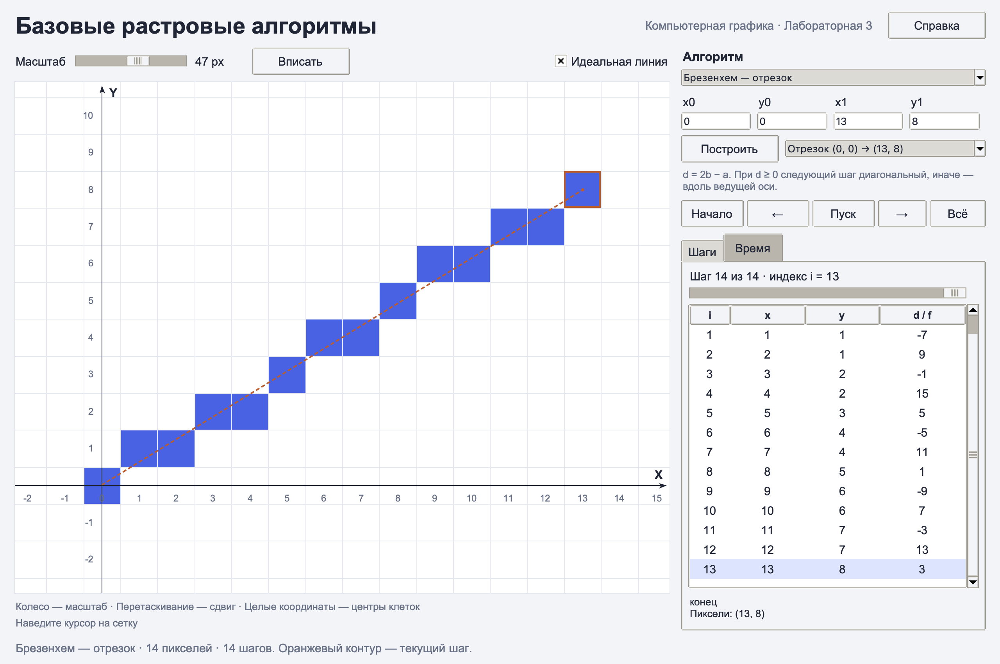

# Лабораторная 3. Базовые растровые алгоритмы

Пошаговый алгоритм, ЦДА, Брезенхем для отрезка и окружности. Дополнительно — сглаживание по схеме Ву. Python + Tkinter, без сторонних пакетов.

[Условие](assignment.pdf) · [Отчёт PDF](report/report.pdf) · [Формулы и пояснения](THEORY.md) · [Замеры времени](benchmark_results.json)

## Запуск

В этой папке дважды щёлкни `Запустить лабораторную.command` (macOS) или `Запустить лабораторную.bat` (Windows).

Вручную из этой папки:

```bash
python3 app.py
```

На Windows — `py app.py`. Нужен Python 3.10+ с Tkinter, устанавливать пакеты через pip не требуется.

## Управление

- Выбери алгоритм, введи целые координаты и нажми «Построить» или Enter. Справа есть готовые примеры.
- Колесо меняет масштаб около курсора, перетаскивание сдвигает сетку. «Вписать» показывает фигуру и начало координат.
- «Начало», стрелки, «Пуск» и ползунок показывают построение по шагам. Можно выбрать строку таблицы. «Всё» показывает весь результат.
- Синий цвет обозначает пиксели, пунктир — идеальную фигуру, оранжевая рамка — текущий шаг. У Ву насыщенность зависит от веса пикселя.
- Во вкладке «Время» можно повторить замер и сохранить JSON.

Целая координата `(x, y)` — **центр** пикселя. Его границы: `[x−0.5, x+0.5) × [y−0.5, y+0.5)`. Ось Y направлена вверх. При уменьшении масштаба часть линий сетки и подписей пропускается. Допустимы координаты от −1000 до 1000 и радиус от 0 до 500.



[Окружность](docs/circle.png) · [Сглаженный отрезок](docs/wu.png)

## Код и проверки

- `raster.py` — сами алгоритмы и необязательная запись шагов.
- `app.py` — окно, масштабирование и управление.
- `benchmark.py` — замеры без интерфейса и без таблицы шагов.

```bash
python3 -m unittest discover -s tests -p 'test_*.py' -v
python3 -m unittest discover -s tests -p 'gui_checks.py' -v
```

Вторая команда открывает тестовое окно. Проверены все октанты, отрицательные координаты, вертикальные и горизонтальные отрезки, одна точка, нулевой радиус, симметрия окружности, веса Ву и работа интерфейса.

## Замеры и отчёт

```bash
python3 benchmark.py
python3 report/make_tables.py
cd report
tectonic report.tex
```

Первая команда обновляет `benchmark_results.json`, вторая — таблицы отчёта. Время зависит от компьютера и текущей нагрузки. Для отрезков измеряются восемь октантов: по 320 вызовов в каждой из пяти серий. Для окружностей — по 40 вызовов. В отчёте указана медиана времени одного вызова.

Готовый [PDF](report/report.pdf) открывается обычным просмотрщиком. Рядом лежит [исходник LaTeX](report/report.tex). Для пересборки нужны Tectonic, Times New Roman (или Liberation Serif) и DejaVu Sans Mono. При первой сборке Tectonic скачивает пакеты TeX.
