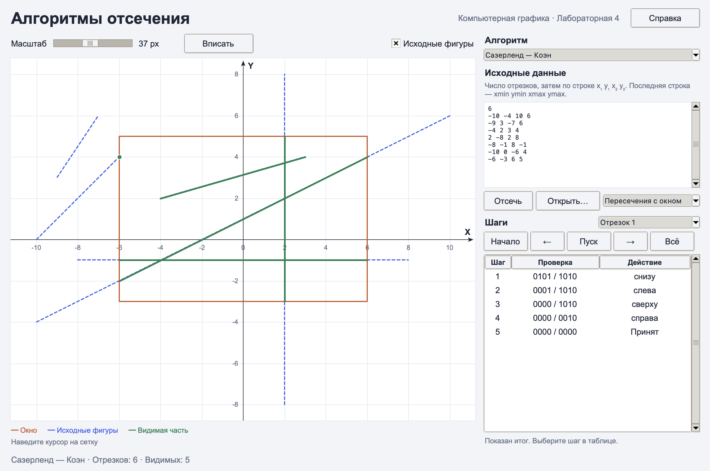

# Лабораторная 4. Алгоритмы отсечения отрезков и многоугольников

Сазерленд — Коэн для отрезков и Сазерленд — Ходжман для выпуклого многоугольника. Вариант 13. Python + Tkinter, без сторонних пакетов.

[Условие](assignment.pdf) · [Отчёт PDF](report/report.pdf) · [Формулы и пояснения](THEORY.md)

## Запуск

В этой папке дважды щёлкни `run.command` (macOS) или `run.bat` (Windows).

Вручную из этой папки на macOS:

```bash
python3 app.py -ApplePersistenceIgnoreState YES
```

Параметр macOS запускает лабораторную без восстановления окон предыдущего сеанса Python. На Windows — `py app.py`. Нужен Python 3.10+ с Tkinter, устанавливать пакеты через pip не требуется.

## Управление

- Выбери алгоритм. Задай координаты в редакторе, открой файл через «Открыть…» или выбери готовый пример. «Отсечь» и Ctrl+Enter запускают расчёт.
- Колесо меняет масштаб около курсора, перетаскивание сдвигает сетку. «Вписать» показывает фигуры и начало координат.
- «Начало», стрелки, «Пуск» и строки таблицы показывают шаги. Для отрезков выбери, чей расчёт показать. «Всё» возвращает итоговый вид.
- Оранжевый цвет обозначает окно, синий пунктир — исходные фигуры, зелёный — видимую часть, фиолетовый — промежуточный результат.



[Отсечение многоугольника](docs/polygon.png)

## Исходные данные

В режиме Сазерленда — Коэна первая строка содержит число отрезков. Далее идут их координаты `x1 y1 x2 y2`, по одному отрезку на строку. Последняя строка задаёт `xmin ymin xmax ymax`. [Пример файла](samples/segments.txt).

В режиме Сазерленда — Ходжмана первая строка содержит число вершин исходного контура, за ней идут пары `x y` в порядке обхода. Затем в том же формате задаётся выпуклое окно. [Прямоугольное окно](samples/polygon.txt) · [Наклонное окно](samples/polygon_slanted.txt).

Координаты от −1000 до 1000, до шести знаков после десятичной точки. В одном файле допускается до 200 отрезков или до 200 строк вершин на контур. Пустые строки пропускаются.

## Код и проверки

- `clipping.py` — разбор данных, коды концов и два алгоритма отсечения.
- `app.py` — окно, координатная сетка, масштабирование и таблица шагов.
- `samples/` — готовые файлы, в том числе случаи касания границы.

```bash
python3 -m unittest discover -s tests -p 'test_*.py' -v
python3 -m unittest discover -s tests -p 'gui_checks.py' -v
```

Вторая команда открывает тестовое окно.

## Отчёт

[PDF](report/report.pdf) и [исходник LaTeX](report/report.tex) лежат в `report/`. Для пересборки нужны Tectonic, Times New Roman (или Liberation Serif) и DejaVu Sans Mono.

```bash
cd report
tectonic report.tex
```
